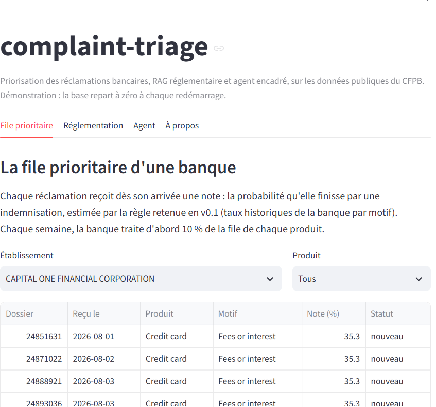

# complaint-triage

*Short English summary. The full README, the reports and the decision records are in French: [README.md](README.md).*

Complaint triage for retail banking, built on the public data of the US financial regulator (CFPB).

A complaints team usually handles cases in order of arrival, yet about one complaint in seven ends with the customer being compensated. Those are the ones to handle first. The tool scores each complaint on arrival, answers regulation questions with verified citations, and lets an agent act on the queue through a small set of controlled tools. When it lacks information, it refuses and says why.

## Live demo

**[complaint-triage-zj94.onrender.com](https://complaint-triage-zj94.onrender.com)**, free, no sign-up. It runs on Render's free plan: if nobody has opened it for 15 minutes, the first load takes about 40 seconds. The interface is in French; questions to the assistant and the agent are asked in English.

- **Priority queue**: public complaints received since August 2026 by the 25 most targeted institutions, scored on arrival.
- **Regulations**: a question in English, an answer that quotes the official text, each quote checked by code against the source; otherwise, a refusal.
- **Agent**: a plain-language request. The agent announces its plan, calls controlled tools, then answers or refuses. Its writes only touch fictitious banks, reset at every restart.

Recorded examples cost nothing. Live questions go through a Gemini key with no billing attached, capped at 5 per visit and 100 per day.

## Results

| Component | Result |
|---|---|
| Prioritisation (v0.1) | XGBoost did not beat a per-bank rate rule on a test period opened once, so the rule was kept. It puts 17.4 % of compensated complaints in the 10 % handled first, against 10 % at random |
| Regulation assistant, RAG (v0.2, v0.4) | 100 % of answers cite a verified source, 100 % of out-of-scope questions refused, no wrong source on a new question set |
| Agent (v0.3, v0.4) | 24 unseen scenarios passed, no unrequested write, five manipulation attempts blocked |
| Engineering (v0.5, v1.0) | Four blocking CI jobs; Dockerised demo ready 4 seconds after start |

Every threshold was set before the work it judges, and every test set was written and committed before being run once. When a model did not clear its threshold, the simpler option was kept and the result documented.

## How it is built

- **Data**: CFPB Consumer Complaint Database (about 524,000 complaints used for modelling), validated with pandera, split in time (train up to mid-2025, validation to end of 2025, test on 2026). The metric is Capture@10 % inside each bank's own weekly queue per product, with fairness (subgroup ratio between 0.8 and 1.25) and calibration (ECE below 0.05) checks.
- **RAG**: Regulations E, Z and DD from the eCFR (394 passages), local embeddings (fastembed, bge-small), Gemini Flash-Lite on the free tier. The model must quote an exact excerpt for each claim, and code checks every quote; one unverifiable quote and the whole answer is refused.
- **Agent**: LangGraph graph (decide, check, execute) over PostgreSQL. Three layers of safety: least-privilege database accounts, seven closed tools validated by pydantic (the model never writes SQL), and a code check of every plan before execution (at most one write, only on a complaint named by the user, no invented identifier).
- **Engineering**: Python 3.12, uv, ruff, strict mypy, pytest. CI on GitHub Actions: unit tests, hostile-model safety scenarios, integration tests on a throwaway PostgreSQL, and both Docker images built and checked (non-root, no secret, 512 MB memory limit). No secret in the code; the Gemini free tier is protected by local daily caps, a disk cache and a hard stop on any rate-limit response.

## Reports (in French)

One PDF report and one decision record per version: [framing](docs/pdf/complaint-triage_v0.0_Rapport-de-cadrage.pdf), [data and scoring](docs/pdf/complaint-triage_v0.1_Rapport-donnees-et-scoring.pdf), [RAG](docs/pdf/complaint-triage_v0.2_Rapport-RAG.pdf), [agent](docs/pdf/complaint-triage_v0.3_Rapport-agent.pdf), [quality](docs/pdf/complaint-triage_v0.4_Rapport-qualite.pdf), [industrialisation](docs/pdf/complaint-triage_v0.5_Rapport-industrialisation.pdf). Decision records are in [docs/adr](docs/adr).

## Author

Nathan Mang, Data Science and AI engineer (ESIEE Paris, 2026).
