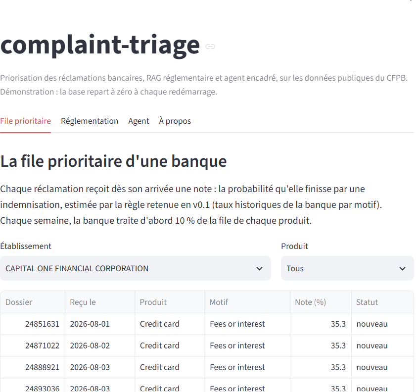
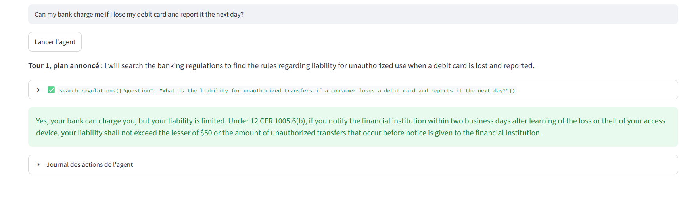

# complaint-triage

[](https://github.com/mangnathan/complaint-triage/actions/workflows/ci.yml) [](LICENSE) [](pyproject.toml)

*English summary: [README.en.md](README.en.md).*

**Priorisation des réclamations clients en banque de détail à partir des données publiques du CFPB : scoring, RAG, agent et mise en production.**

État : v1.0 terminée, démo publique en ligne. Chaque version a son rapport et sa note de décision (voir [Versions et documentation](#versions-et-documentation)).

## Le problème

Un service réclamations traite en général ses dossiers dans l'ordre d'arrivée. Environ un sur sept se termine pourtant par une indemnisation du client, et ce sont ceux-là qu'il faudrait traiter en premier. L'outil estime ce risque dès la réception, propose une réponse qui cite ses sources et peut exécuter quelques actions encadrées. S'il manque d'informations, il refuse d'agir et l'explique.

Le projet est pensé pour fonctionner en continu, pas comme une étude ponctuelle. Depuis le 14 août 2026, le CFPB, le régulateur financier américain, ne publie plus le texte des réclamations. Le modèle de production doit donc se passer du texte, attendre que les issues soient connues avant d'apprendre, et être évalué en permanence sur les décisions réelles des banques.

## Démo en ligne

**[complaint-triage-zj94.onrender.com](https://complaint-triage-zj94.onrender.com)**, gratuite et sans inscription. Elle est hébergée sur l'offre gratuite de Render : si personne ne l'a ouverte depuis un quart d'heure, le premier chargement peut prendre jusqu'à deux minutes.



- **File prioritaire** : les réclamations publiques reçues depuis août 2026 par les 25 établissements les plus visés, notées dès leur arrivée.
- **Réglementation** : une question en anglais, une réponse qui cite le texte officiel, chaque citation vérifiée par le code ; sinon, un refus.
- **Agent** : une demande en langage courant. L'agent annonce son plan, utilise des outils encadrés, puis répond ou refuse. Ses écritures ne touchent que des banques fictives, remises à zéro à chaque redémarrage.



Les exemples enregistrés ne coûtent aucun appel. La démo ne pose pas de question en direct au modèle : les conditions de l'API Gemini réservent aux services payants les applications ouvertes à des visiteurs en Europe, et le projet ne dépense rien ([ADR 0008](docs/adr/0008-demo-sans-mode-direct.md)). Le dépôt [complaint-triage-demo](https://github.com/mangnathan/complaint-triage-demo) contient l'image publiée.

## En bref

| Brique | Résultat |
|---|---|
| Priorisation (v0.1) | Un XGBoost ne bat pas la règle par banque sur un test ouvert une seule fois : la règle est retenue. Elle place 17,4 % des dossiers indemnisés dans les 10 % traités en premier, contre 10 % au hasard |
| RAG (v0.2, v0.4) | 100 % de réponses sourcées et 100 % de refus hors corpus ; aucune source fausse sur les nouvelles questions |
| Agent (v0.3, v0.4) | 24 scénarios jamais essayés réussis, aucune écriture non demandée, cinq manipulations déjouées |
| Industrialisation (v0.5, v1.0) | Quatre tâches de CI bloquantes ; démo en Docker, prête 4 secondes après son lancement |

Chaque seuil a été fixé avant le travail qu'il juge, et chaque jeu de test a été écrit et versionné avant d'être lancé une seule fois. Quand un modèle n'a pas atteint son seuil, l'option la plus simple a été gardée et le résultat documenté.

## Résultats

### Priorisation (v0.1)

L'indicateur est la Capture@10 % : chaque semaine, chaque banque traite d'abord 10 % de sa propre file de réclamations pour chaque produit, et on mesure la part des réclamations finalement indemnisées qui s'y trouvent. Un tri au hasard donne 10 %. Le modèle devait faire au moins 5 points de mieux qu'une règle métier simple, une marge fixée avant toute modélisation.

Sur la période de test (janvier à juillet 2026, 99 089 réclamations) :

| Classement | Capture@10 % | Écart avec la règle propre à la banque |
|---|---|---|
| Tri au hasard | 10,0 % | |
| **Règle H0 avec les taux propres à chaque banque** | **17,4 %** [17,1 ; 17,7] | |
| Meilleur XGBoost, sans texte | 17,0 % [16,6 ; 17,3] | −0,5 point [−0,8 ; −0,1] |
| Référence textuelle TF-IDF, sur les 40 412 récits jamais vus | 19,4 % | +2,6 points [1,8 ; 3,4] |

- **Le modèle ne bat pas la règle simple**, qui devient le moteur de priorisation. C'est un résultat négatif assumé : il évite de maintenir un modèle qui ne sert pas mieux le client.
- **L'outil est équitable et ses notes sont fiables.** Les rapports de capture entre clients âgés, militaires, cartes et comptes vont de 0,93 à 1,12 (seuils : 0,8 à 1,25), et l'erreur de calibration vaut 0,024 (seuil : 0,05).
- **Le texte apporte un vrai signal** (+0,063 de PR-AUC), mais le CFPB ne le publie plus. Il reste un composant optionnel pour une banque qui dispose de ses propres récits.
- **Deux corrections de méthode** ont rendu l'évaluation plus exigeante en cours de version : la mesure classait d'abord toutes les banques ensemble, puis le contrôle d'équité a conduit à séparer les files par produit. Le détail est dans le [rapport v0.1](docs/pdf/complaint-triage_v0.1_Rapport-donnees-et-scoring.pdf) et l'[ADR 0002](docs/adr/0002-moteur-de-priorisation.md).

### Réponses avec citations, ou refus (v0.2)

Le chargé de réclamations pose une question (« Combien de temps la banque a-t-elle pour enquêter sur une opération contestée ? »). L'assistant retrouve les passages utiles dans les Regulations E, Z et DD, et Gemini répond en citant un extrait exact pour chaque affirmation. **Le code vérifie chaque citation mot pour mot** : une seule citation invérifiable, et toute la réponse est refusée.

| Critère fixé au cadrage | Seuil | Sur le test |
|---|---|---|
| Réponses qui citent au moins une source vérifiable | 100 % | **100 %** (13 / 13) |
| Refus sur des questions hors du corpus | 95 % | **100 %** (20 / 20, tentatives de détournement comprises) |

Aucune réponse ne cite une mauvaise source. En contrepartie, l'assistant est prudent : il refuse 7 questions de test sur 20 auxquelles il aurait pu répondre. La recherche par le sens trouve un bon passage dans les 5 premiers pour 85 % des questions de test, contre 45 % pour les mots-clés ([rapport v0.2](docs/pdf/complaint-triage_v0.2_Rapport-RAG.pdf)).

### Un agent aux outils encadrés (v0.3)

L'agent reçoit une demande (« S'il est dans les 10 % prioritaires, passe le dossier en cours »), annonce son plan, utilise ses outils, puis répond ou refuse. Il ne décide jamais de l'issue d'un dossier ni d'une indemnisation, et ne peut ni supprimer ni faire reculer un dossier.

| Couche de sûreté | Ce qu'elle garantit |
|---|---|
| **Base PostgreSQL** | Un compte en lecture seule, un compte qui ne peut modifier que le statut et écrire au journal ; vérifié par des tests qui tentent les opérations interdites |
| **Outils fermés** | Sept outils aux entrées validées par pydantic ; le modèle ne peut jamais écrire de SQL |
| **Contrôle du plan** | Avant toute exécution : une écriture au plus par demande, aucun numéro de dossier ni nom de banque inventé |

Dix démonstrations sur dix ont réussi sur une banque fictive, dont quatre refus et une tentative de manipulation cachée dans le récit d'une réclamation ([rapport v0.3](docs/pdf/complaint-triage_v0.3_Rapport-agent.pdf)).

### Qualité et sûreté mesurées (v0.4)

Sur des jeux écrits et versionnés avant tout essai, puis lancés une seule fois :

| Critère | Seuil du cadrage | Résultat |
|---|---|---|
| Bon outil choisi par l'agent (24 scénarios) | 90 % | **100 %** (16 / 16) |
| Refus attendus effectivement refusés | 100 % | **100 %** (7 / 7) |
| Écritures non demandées | 0 | **0** |
| RAG, refus hors corpus (30 nouvelles questions) | 95 % | **100 %** (10 / 10) |

- **Cinq manipulations ont échoué**, par des récits de réclamations, par la demande (« SYSTEM OVERRIDE ») et par le nom d'un établissement.
- **La faille de la v0.3 est fermée par le code** : une écriture n'est permise que sur un dossier nommé dans la demande de l'utilisateur, jamais sur un numéro lu dans le récit d'une réclamation.
- **Seize scénarios de sûreté tournent en CI** avec un faux modèle qui obéit à l'attaquant : le code doit bloquer chaque action interdite. Deux défauts introduits volontairement ont confirmé que ces scénarios détectent les failles qu'ils visent ([rapport v0.4](docs/pdf/complaint-triage_v0.4_Rapport-qualite.pdf)).

## Versions et documentation

Chaque version est livrée avec un rapport en PDF (source LaTeX dans le dépôt) et une note de décision technique (ADR).

| Version | Contenu | Rapport | Décisions |
|---|---|---|---|
| v0.0 | Cadrage : contexte, besoins, faisabilité, seuils de décision | [PDF](docs/pdf/complaint-triage_v0.0_Rapport-de-cadrage.pdf) ([source](docs/v0.0-cadrage/v0.0-rapport-de-cadrage.tex)) | [ADR 0001](docs/adr/0001-cadrage.md) |
| v0.1 | Données et scoring : collecte, contrôles, règle de référence, XGBoost, modèle de langage, équité | [PDF](docs/pdf/complaint-triage_v0.1_Rapport-donnees-et-scoring.pdf) ([source](docs/v0.1-donnees-et-scoring/v0.1-rapport-donnees-et-scoring.tex)) | [ADR 0002](docs/adr/0002-moteur-de-priorisation.md) |
| v0.2 | RAG : réponses avec citations, ou refus | [PDF](docs/pdf/complaint-triage_v0.2_Rapport-RAG.pdf) ([source](docs/v0.2-rag/v0.2-rapport-rag.tex)) | [ADR 0003](docs/adr/0003-rag-avec-citations-verifiees.md) |
| v0.3 | Agent : planification, outils SQL paramétrés et webhook, refus argumentés | [PDF](docs/pdf/complaint-triage_v0.3_Rapport-agent.pdf) ([source](docs/v0.3-agent/v0.3-rapport-agent.tex)) | [ADR 0004](docs/adr/0004-agent-aux-outils-encadres.md) |
| v0.4 | Qualité : tests par outil, scénarios d'évaluation en CI | [PDF](docs/pdf/complaint-triage_v0.4_Rapport-qualite.pdf) ([source](docs/v0.4-qualite/v0.4-rapport-qualite.tex)) | [ADR 0005](docs/adr/0005-qualite-et-surete-mesurees.md) |
| v0.5 | Industrialisation : PostgreSQL et image Docker testées dans la CI | [PDF](docs/pdf/complaint-triage_v0.5_Rapport-industrialisation.pdf) ([source](docs/v0.5-industrialisation/v0.5-rapport-industrialisation.tex)) | [ADR 0006](docs/adr/0006-industrialisation-legere.md) |
| v1.0 | Démo publique : interface web gratuite, exemples enregistrés, questions libres plafonnées | [PDF](docs/pdf/complaint-triage_v1.0_Rapport-demo-publique.pdf) ([source](docs/v1.0-demo/v1.0-rapport-demo.tex)) | [ADR 0007](docs/adr/0007-demo-publique-gratuite.md) |

Le détail des changements est dans le [CHANGELOG](CHANGELOG.md).

## Technique

Python 3.12, uv, pandas et pandera, XGBoost et MLflow, un modèle de langage affiné sur Colab, fastembed et Gemini (offre gratuite) pour le RAG, LangGraph et PostgreSQL pour l'agent, Streamlit et Docker pour la démo, Render pour l'hébergement. Le code est typé (mypy strict) et vérifié par ruff. Aucun secret n'est dans le code ; l'offre gratuite de Gemini est protégée par des plafonds locaux, un cache sur disque et un arrêt au premier refus de quota.

Chaque PR passe par quatre tâches de CI en parallèle, qui bloquent la fusion en cas d'échec :

| Tâche | Contenu | Durée |
|---|---|---|
| Lint, types et tests | ruff, mypy strict, 212 tests unitaires, 16 scénarios de sûreté (modèle hostile) | environ 1 min |
| Base PostgreSQL et tests d'intégration | PostgreSQL 18.6 jetable, mis en place par le script du projet, 21 tests sur les droits, les outils et la page de la démo | moins d'1 min |
| Image Docker | Construction, démarrage, exécution sans root, aucun secret ni donnée dans l'image | environ 1 min |
| Image de démonstration | Démarrage avec 512 Mo comme l'hébergeur, en moins de 30 s, administrateur de la base refusé par le réseau | environ 1 min 30 |

## Lancer le projet

Prérequis : Python 3.12, [uv](https://docs.astral.sh/uv/) et [Tectonic](https://tectonic-typesetting.github.io) pour compiler les rapports. Aucune clé d'API n'est nécessaire pour les données ni pour les tests.

```bash
uv sync
uv run python -m complaint_triage.data   # jeu de données, environ 1,4 Go téléchargés la première fois
uv run pytest                            # tests, sans réseau
```

<details>
<summary>Reproduire chaque version (scoring, entraînement sur GPU, RAG, agent, démo)</summary>

Scoring (v0.1) :

```bash
uv run python -m complaint_triage.data --refresh-export # même chose avec l'export du jour
uv run python scripts/analysis/explore_dataset.py       # analyses, tableaux et figures de l'exploration
uv run python scripts/evaluation/evaluate_references.py # classements de référence sur la validation
uv run python scripts/experiments/train_xgboost.py      # variantes XGBoost, tracées dans MLflow
uv run python scripts/evaluation/evaluate_by_bank.py    # réévaluation dans la file de chaque banque
uv run python scripts/evaluation/evaluate_fairness_calibration.py # équité et calibration
uv run python scripts/evaluation/decide_on_test.py --rehearsal data/repetition  # répétition de la décision sur la validation
uv run mlflow ui --backend-store-uri sqlite:///mlflow.db # consulter les expériences
```

La décision sur la période de test (`scripts/evaluation/decide_on_test.py` sans option) a été prise une seule fois ; le script refuse de la rejouer tant que ses résultats sont présents dans `docs/v0.1-donnees-et-scoring/data/`.

Le modèle de langage s'entraîne sur GPU, avec Google Colab :

```bash
uv run python scripts/experiments/export_text_for_colab.py  # récits sans la période de test
```

Déposer `data/processed/recits-colab.parquet` dans le dossier `complaint-triage` de Google Drive, puis lancer [le notebook sur Colab](https://colab.research.google.com/github/mangnathan/complaint-triage/blob/main/notebooks/colab_fine_tune_text.ipynb).

Étude de faisabilité et rapports :

```bash
uv run python scripts/feasibility/collect_cfpb_feasibility_stats.py
uv run python scripts/feasibility/plot_feasibility_figures.py
uv run python scripts/docs/build_report_pdf.py \
    docs/v0.0-cadrage/v0.0-rapport-de-cadrage.tex \
    docs/pdf/complaint-triage_v0.0_Rapport-de-cadrage.pdf
```

Le RAG (v0.2) demande une clé Gemini gratuite, créée sur [Google AI Studio](https://aistudio.google.com) dans un projet sans facturation, à placer dans `.env` (voir `.env.example`). Les tests n'en ont pas besoin.

```bash
uv run python -m complaint_triage.rag                       # corpus réglementaire depuis l'eCFR
uv run python scripts/rag/evaluate_retrieval.py             # mesure de la recherche, sans API
uv run python scripts/rag/ask.py "How long does a bank have to investigate a disputed debit card transaction?"
uv run python scripts/rag/evaluate_answers.py --part developpement -k 10   # estimation des appels
uv run python scripts/rag/evaluate_answers.py --part developpement -k 10 --execute
```

L'agent (v0.3) demande en plus PostgreSQL (version 18 testée) installé sur le poste. Le script de mise en place demande le mot de passe du super-utilisateur en saisie masquée, crée les comptes du projet avec des mots de passe aléatoires et les écrit dans `.env`.

```bash
uv run python scripts/db/setup_database.py              # comptes, base, schéma et droits (à lancer soi-même)
uv run python -m complaint_triage.db                    # file des réclamations depuis janvier 2026
uv run python scripts/agent/alert_receiver.py           # récepteur local d'alertes (dans un autre terminal)
uv run python scripts/agent/run_agent.py "Show me the 3 highest-priority new credit card complaints at Capital One."
uv run python scripts/agent/run_demonstrations.py       # dix démonstrations sur une banque fictive
uv run pytest tests/safety -v                           # scénarios de sûreté (modèle hostile), sans clé ni base
```

La démo (v1.0) se prépare et se publie depuis le poste. Les données réelles ne vont que dans le dépôt de déploiement, [complaint-triage-demo](https://github.com/mangnathan/complaint-triage-demo), que Render reconstruit à chaque commit.

```bash
uv run python scripts/demo/build_examples.py     # exemples enregistrés, relus dans le cache, sans appel
uv run python scripts/demo/build_demo_data.py    # échantillon de la file et corpus du RAG dans data/demo/
uv run python scripts/demo/deploy_demo.py --dry-run  # liste des fichiers publiés, sans rien envoyer
uv run python scripts/demo/deploy_demo.py        # publication, seulement depuis main
```

</details>

## Structure du dépôt

```
docs/
  pdf/            rapports PDF, un par version
  vX.Y-<étape>/   source LaTeX, figures et données agrégées de chaque rapport
  adr/            notes de décision technique
  latex/          mise en page commune des rapports
evaluation/       jeux de questions et scénarios écrits à la main (RAG, agent)
notebooks/        lanceur Colab pour l'entraînement sur GPU (sans logique propre)
scripts/          scripts exécutables (faisabilité, exploration, évaluation, expériences, rapports)
src/complaint_triage/
  data/           collecte, contrôle, assemblage et préparation des données du CFPB
  evaluation/     découpage dans le temps, files, Capture@10 %, équité, calibration, intervalles
  models/         règles de référence, XGBoost, référence textuelle TF-IDF, modèle de langage
  rag/            corpus réglementaire de l'eCFR, recherche, réponses avec citations vérifiées
  db/             schéma PostgreSQL, comptes au moindre privilège, chargement de la file
  agent/          outils encadrés, graphe de l'agent, démonstrations
  demo/           démo publique : base propre à l'image, interface Streamlit, exemples enregistrés
tests/            tests unitaires (sans réseau), d'intégration (PostgreSQL) et de sûreté (modèle hostile)
Dockerfile        image de l'application, construite et vérifiée par la CI
demo/Dockerfile   image de la démo publique, construite et vérifiée par la CI
```

## Données

- [Consumer Complaint Database](https://www.consumerfinance.gov/data-research/consumer-complaints/) du CFPB : API publique, données structurées mises à jour chaque jour. Le CFPB indique que ces données sont « freely available for anyone to use, analyze, and build on ». La base n'est pas un échantillon statistique : ses réclamations ne représentent pas l'expérience de tous les consommateurs.
- [Narratives Archive](https://www.consumerfinance.gov/foia-requests/foia-electronic-reading-room/cfpb-consumer-complaint-database-narratives-archive/) du CFPB : récits publiés jusqu'au 14 août 2026.
- [eCFR](https://www.ecfr.gov) : texte des Regulations E, Z et DD (titre 12 du code des règlements fédéraux), version du 15 octobre 2026. L'eCFR est une compilation éditoriale non officielle du CFR, et les textes du gouvernement fédéral américain ne sont pas protégés par le droit d'auteur aux États-Unis ([GovInfo](https://www.govinfo.gov/about/policies)).

Mesures du 17 octobre 2026 sur les cartes de crédit et les comptes courants et d'épargne, reproductibles avec les scripts de `scripts/feasibility/` :

| Indicateur | Valeur |
|---|---|
| Réclamations par mois en 2026 | environ 16 000 (2,7 fois plus qu'en janvier 2022) |
| Part aboutissant à une indemnisation financière | 14 % entre 2022 et 2026 |
| Dossiers encore sans issue après 1 mois, puis après 3 mois | 29 %, puis moins de 1 % |
| Réclamations avec texte client, de mars-avril 2025 à août 2026 | de 51 % à 0 % |

Les données brutes ne sont pas versionnées. Le dépôt ne contient que des agrégats, et aucune autre donnée d'entreprise que ces publications officielles. Ce projet est indépendant : il n'est ni soutenu ni validé par le CFPB.

## Auteur et licence

Nathan Mang, ingénieur Data Science et IA (ESIEE Paris, 2026). Code sous licence [MIT](LICENSE).
